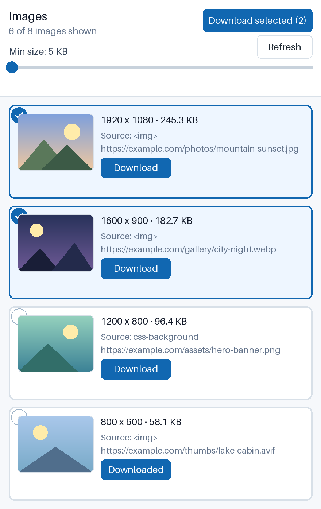

# Simple Image Downloader


A lightweight Chrome / Chromium extension (Manifest V3) that finds images on the page you are viewing, sorts them by resolution, and lets you download the ones you want. No accounts, no tracking, no backend — everything runs locally in your browser.



## What it does

- **Finds images** on the current tab: regular `` elements (including `srcset` and lazy-loaded images), `<picture>` sources, linked image files, and CSS background images.
- **Sorts them** from largest resolution to smallest, so the best-quality images are always on top.
- **Shows details** for each image: a preview thumbnail, dimensions (e.g. `1920 x 1080`), file size when the server provides it, and where the image was found.
- **Downloads** a single image with its own `Download` button, or several at once: click rows to select them, then press `Download selected`.
- **Filters by size** with the `Min size` slider (0–512 KB, default 5 KB, remembered between sessions) to hide tiny icons and thumbnails.

Supported formats: JPG, JPEG, PNG, WEBP, GIF, AVIF.

## How it works

1. You click the extension icon. Nothing runs until then.
2. The extension injects a small scanner script into the **current tab only** (via `activeTab` + `scripting` — no broad host permissions).
3. The scanner collects image URLs and dimensions from the page and returns them to the popup.
4. For images without known file size, the background service worker sends a lightweight `HEAD` (plus a tiny `Range` fallback) request to read the size, with a timeout. Responses that are not images are filtered out.
5. Downloads go through Chrome's built-in download manager (`downloads` permission), so files land in your normal Downloads folder.

## How to install the extension

### Option A: Load it unpacked (easiest, for daily use)

1. Download or clone this repository to your computer.
2. Open Chrome (or Brave, Edge, Opera, Vivaldi — any Chromium browser) and go to `chrome://extensions`.
3. Turn on **Developer mode** (toggle in the top-right corner).
4. Click **Load unpacked**.
5. Select this project folder (the one containing `manifest.json`).
6. Done — the extension icon appears in your toolbar. You can pin it by clicking the puzzle-piece icon and pinning **Simple Image Downloader**.

### Option B: Install from a ZIP

1. Download the release ZIP and unzip it anywhere.
2. Follow steps 2–5 of Option A, selecting the unzipped folder.

> To update later, pull the latest code (or unzip the new version over the old folder) and press the **reload** button on the extension card at `chrome://extensions`.

## How to use

1. Open any regular web page (`http://` or `https://`) with images.
2. Scroll through the page first if images load lazily as you scroll.
3. Click the **Simple Image Downloader** icon in the toolbar.
4. Wait a moment while images are listed — largest first.
5. Optional: move the **Min size** slider to hide small files.
6. Click a row to select it (click again to deselect), or press **Download** next to one image.
7. Press **Download selected** to save everything you selected.

> Note: browsers block extensions on internal pages such as `chrome://extensions` or the web store itself. If the popup says the page can't be scanned, open a normal website instead.

## Privacy

- No personal data is collected, stored, sold, or shared.
- No analytics, ads, tracking, accounts, or external servers.
- Image URLs and metadata are processed locally in Chrome and discarded when the popup closes.

See [PRIVACY.md](PRIVACY.md) for the full policy.

## Limitations

- File size shows as `unknown` when a server doesn't expose it via headers.
- Images with unknown size stay visible while the size filter is active, since the extension can't confirm they are below the threshold.
- Some sites protect images (hotlink protection, login walls); those downloads may fail in the browser.
- Downloading many images at once triggers one browser notification per file.

## For developers

```bash
npm test        # run unit tests
npm run package # run tests, rebuild icons, create dist/simple-image-downloader.zip
```

Project layout:

| Path | Purpose |
| --- | --- |
| `manifest.json` | Extension metadata and permissions (MV3) |
| `src/popup.html`, `src/popup.css`, `src/popup.js` | Popup UI |
| `src/pageScanner.js` | Code injected into the tab to find images |
| `src/background.js` | Service worker: size checks and downloads |
| `src/imageUtils.js`, `src/pageScanUtils.js`, `src/sizeResolver.js`, `src/sizeFilter.js`, `src/pageGuard.js`, `src/renderBatcher.js`, `src/popupInteractionUtils.js`, `src/asyncResultCache.js` | Shared logic |
| `icons/` | Extension icons (regenerate with `npm run build:icons`) |
| `tests/` | Unit tests (`node:test`) |
| `screenshots/` | README screenshots |
| `PRIVACY.md`, `STORE_LISTING.md` | Privacy policy and store listing draft |
